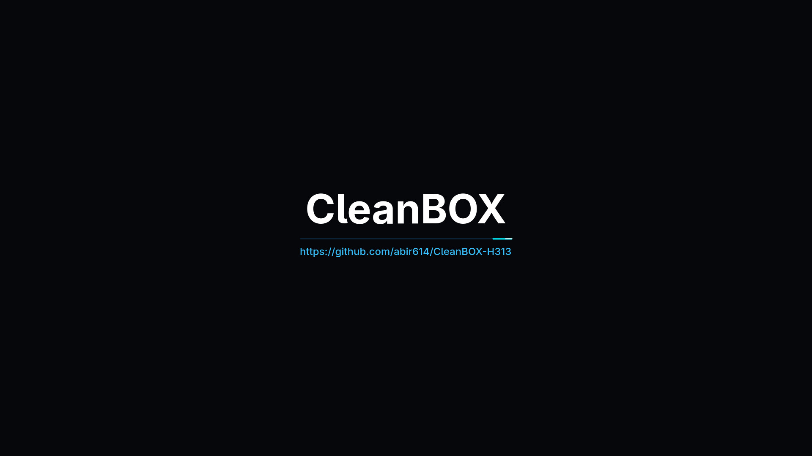

# CleanBOX-H313 🚀

**Ultra-Clean, Hardened, High-Performance Android TV Firmware & Tools for Allwinner H313 / H616 TV Boxes**



---

## 🌟 Overview

Budget Allwinner H313 and H616 TV boxes (such as the **TX9 Pro**, **TX20 Pro**, **T95**, and **X96Q**) are popular for their value, but nearly all of them ship from factories plagued by:
* **BadBox Malware & Backdoors:** Silent background botnets (`shext`, `icore`, `uota`) communicating with rogue remote servers.
* **Severe Bloatware & Spyware:** 110+ unnecessary phone/telephony packages consuming limited RAM.
* **Frozen Front Displays:** LED glass stuck perpetually showing `boot` due to driver and init flaws.
* **Broken Peripherals & Missing Drivers:** Wi-Fi 6 (SeekWave EA6521QF) and Bluetooth crashing or non-functional.
* **Sluggish UI & Permission Blocks:** Aggressive background throttling and blocked in-app updates.

**CleanBOX-H313** is an open, community-driven firmware platform and optimization suite designed to turn these budget boxes into **production-ready, ultra-fast, and hardened streaming powerhouses**.

---

## ✨ Key Features

* **🛡️ 100% Malware-Free & Disarmed:**  
  Neutralizes factory botnets (`shext`, `icore`, `uota`) with immutable filesystem traps. Zero rogue outbound sockets.
* **⚡ 1 GB RAM Optimization (32-bit Lean Userspace):**  
  Uses Android TV 10 with a lightweight 32-bit `armeabi-v7a` userspace. Reduces background packages from **118 down to just 33 essential packages**, keeping **~500 MB of physical RAM completely free** (unlike bloated 64-bit Android 12/13 builds which exhaust 1 GB hardware).
* **📶 First-Ever SeekWave EA6521QF Wi-Fi 6 & BT 5.0 Stack:**  
  Fully recovered and integrated Linux 4.9 kernel drivers (`skw.ko`, `skw_sdio.ko`), firmware, and vendor HALs for dual-band 802.11ax Wi-Fi 6 and Bluetooth 5.0.
* **📡 Broad SSV6256P / SSV6158 Wi-Fi Support:**  
  Native support for South Silicon Valley Wi-Fi 5 chipset.
* **🕒 Dynamic Front LED Panel Daemon (`fd655_panel`):**  
  Battery-efficient, supervised Android `init` daemon that displays real-time clock (12h/24h), active middle colon (`:`), Wi-Fi status, and unified USB connectivity. Uses volatile RAM `/dev/` pidfiles to guarantee the display never gets stuck on `boot`.
* **🔄 Seamless 1-Click In-App Updates:**  
  Includes a persistent boot-time auto-permission engine ([grant_sideload_perms.sh](system/bin/grant_sideload_perms.sh)) that pre-authorizes `REQUEST_INSTALL_PACKAGES` and storage access for sideloaded apps (SmartTube, CloudStream, X-plore).
* **🎨 Modern UI & CleanBOX Boot Animation:**  
  Includes the clean, pitch-black **CleanBOX** glowing typography boot animation and ships with the hardware-accelerated **Projectivy Launcher** at 1280x720 (160 DPI).

---

## 📊 Benchmark Comparison: TX9 Pro vs. TX20 Pro

Live verified benchmarks executed directly across both Allwinner H313 reference devices:

| Metric | TX9 Pro (`walley`) | TX20 Pro (`cupid`) | Notes |
| :--- | :--- | :--- | :--- |
| **SoC Processor** | Allwinner H313 (4x A53 @ 1.3GHz) | Allwinner H313 (4x A53 @ 1.3GHz) | Quad-Core ARM Cortex-A53 |
| **Cold Boot Duration** | **29.59 seconds** | **33.99 seconds** | Fast cold start to launcher |
| **DRAM Hardware Clock** | 600 MHz (DDR3-1200) | **648 MHz (DDR3-1296)** | TX20 has +8% raw memory clock |
| **Kernel Pipe Bandwidth** | **3.7 GB/s** | 1.5 GB/s | Linux memory buffer copy |
| **Physical RAM Write (tmpfs)** | **367 MB/s** | 257 MB/s | Sequential memory page write |
| **Physical RAM Read (tmpfs)** | **491 MB/s** | 368 MB/s | Sequential memory page read |
| **eMMC Sequential Write** | 30.0 MB/s | 28.0 MB/s | Hardware flash write (`fsync`) |
| **eMMC Sequential Read** | **859 MB/s** | 585 MB/s | Cached read throughput |
| **Wi-Fi Generation** | Wi-Fi 5 (802.11ac) | **Wi-Fi 6 (802.11ax)** | SeekWave EA6521QF on TX20 |
| **Wi-Fi Ping to Gateway** | **1.84 ms avg** | 3.81 ms avg | 0% packet loss |
| **Remote Technology** | IR Remote | **Bluetooth 5.0 + Gyro Air-Mouse** | `Remoter ATV3` BLE + IR |
| **Active Packages** | **33 packages** | 34 packages | Stripped from 118 stock bloat |
| **Available RAM** | **~503 MB free** | ~453 MB free | +727 MB fast ZRAM swap |

---

## 📁 Repository Structure

```text
CleanBOX-H313/
├── drivers/
│   ├── seekwave/         # SeekWave EA6521QF Wi-Fi 6 + BT 5.0 modules, FW & HALs
│   └── ssv/              # SSV6256P / SSV6x5x Wi-Fi 5 modules & firmware
├── media/
│   ├── bootanimation.zip        # CleanBOX Neon Synthwave Horizon boot animation
│   ├── cleanbox_splash.png      # 1280x720 Stage 1 Bootloader splash reference
│   ├── cleanbox_boot_preview.jpg
│   └── cleanbox_boot_video.mp4
├── system/
│   ├── bin/
│   │   ├── fd655_panel            # Front LED display supervised daemon
│   │   └── grant_sideload_perms.sh # In-app update permission engine
│   ├── etc/init/
│   │   └── fd655_panel.rc         # Android init service definition
│   └── usr/keylayout/
│       ├── customer_ir_df00.kl    # Tanix / standard NEC IR remote keymap
│       └── Vendor_1d5a_Product_c081.kl # Remoter ATV3 Bluetooth BLE Air-Mouse layout
├── tools/
│   ├── debloat-box.sh           # Automated debloater script for stock Allwinner ROMs
│   └── patch-bootloader-splash.py # Stage 1 bootloader splash patch tool (FAT16)
└── README.md
```

---

## 🛠️ How to Apply to Your Box

### Quick Fix via Root ADB:
If you are already running an Allwinner H313/H616 ROM and want to apply the CleanBOX fixes:

```bash
# 1. Connect ADB over USB or Network
adb connect <DEVICE_IP>:5555
adb root
adb remount

# 2. Deploy Front LED Panel Daemon
adb push system/bin/fd655_panel /system/bin/
adb push system/etc/init/fd655_panel.rc /system/etc/init/
adb shell "chmod 755 /system/bin/fd655_panel && setprop ctl.restart fd655_panel"

# 3. Deploy In-App Update Auto-Permission Engine
adb push system/bin/grant_sideload_perms.sh /vendor/bin/
adb shell "chmod 755 /vendor/bin/grant_sideload_perms.sh"

# 4. Deploy CleanBOX Boot Animation (Stage 2)
adb push media/bootanimation.zip /system/media/bootanimation.zip
adb shell "chmod 644 /system/media/bootanimation.zip"

# 5. Lock filesystem back to read-only
adb shell "mount -o remount,ro / && mount -o remount,ro /vendor"

# 6. (Optional) Patch Stage 1 Bootloader Splash (Seconds 0–5)
# Dump device bootloader, patch OEM bitmap, and flash back:
adb shell "dd if=/dev/block/by-name/bootloader of=/data/local/tmp/bootloader.img bs=1M"
adb pull /data/local/tmp/bootloader.img ./bootloader.img
python3 tools/patch-bootloader-splash.py ./bootloader.img ./cleanbox_splash.bmp ./bootloader_cleanbox.img
adb push ./bootloader_cleanbox.img /data/local/tmp/bootloader_cleanbox.img
adb shell "dd if=/data/local/tmp/bootloader_cleanbox.img of=/dev/block/by-name/bootloader bs=1M && sync"
adb shell "rm -f /data/local/tmp/bootloader*.img"
```

---

## 🙏 Credits & Acknowledgments

* **SlimHouse ([slimboxtv.ru](https://slimboxtv.ru)):** For the SlimBOXtv Android TV 10 foundation.
* **Allwinner Technology:** For the `sun50iw9p1` platform and Mali-G31 GPU stack.
* **Projectivy Launcher:** For the fluid, lean Leanback home interface.
* **SmartTube & CloudStream:** For the ad-free, open-source media streaming suite.

---

## ⚖️ License

* The system scripts, configuration files, keymaps, and documentation are licensed under the **Apache License 2.0**.
* Kernel modules, drivers, and vendor binaries retain the respective licenses of their original authors (GPL-2.0 / Allwinner / SeekWave).
